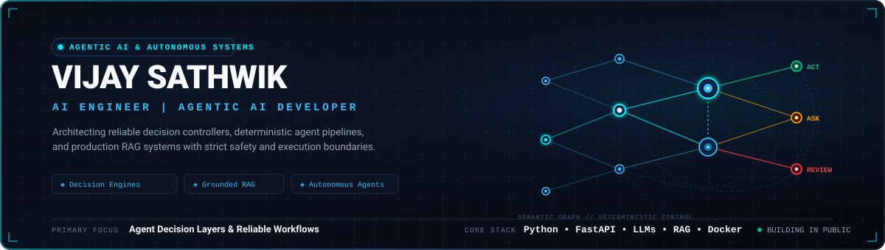
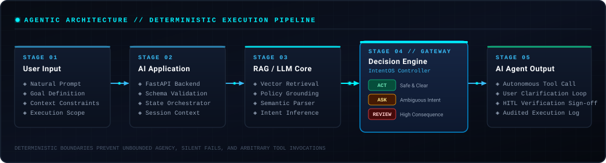

  

    

  
  
  

    

  

    <strong>AI Engineer &bull; Agentic AI Developer &bull; Systems Thinker</strong> 
    <em>Architecting reliable decision controllers, deterministic agent pipelines, and grounded RAG systems.</em>
  

---

### ◈ Executive Profile

I am an **AI Engineer and Agentic AI Developer** specializing in building reliable, production-ready AI systems. My work focuses on bridging the gap between probabilistic generative models and deterministic production software. Rather than treating AI agents as black-box generators, I design structured execution layers that evaluate intent, quantify consequence risk, and enforce safety boundaries before autonomous tool calls execute.

- 🎓 **Education**: B.Tech in Computer Science and Engineering &mdash; Artificial Intelligence (Class of 2027)
- 📊 **Academic Performance**: Current CGPA: **7.9** *(Target / Expected: 8.5)*
- 🎯 **Career Trajectory**: AI Engineer &bull; AI Application Developer &bull; Agentic AI Developer
- 📍 **Focus Areas**: Agentic AI Architecture, Retrieval-Augmented Generation (RAG), Deterministic Decision Gates, Full-Stack AI Services

---

### ◈ Architectural Philosophy

Modern autonomous systems cannot rely on model confidence alone. Reliable agentic workflows require clear evaluation boundaries that decompose intent, retrieve grounding context, and enforce strict execution gates.

  

 

The architecture enforces a four-stage boundary:
1. **Perception & Validation**: Captures user requests, structured parameters, and session state via a hardened API gateway.
2. **Context & Policy Retrieval (RAG)**: Grounds requests with semantic vector retrieval to prevent unsupported assertions.
3. **Deterministic Decision Engine**: Evaluates ambiguity and consequence risk before any execution step is authorized.
4. **Governed Agent Action**: Safely transitions into autonomous action (`ACT`), interactive clarification (`ASK`), or human sign-off (`REVIEW`).

---

### ◈ Featured System: IntentOS

  
  
  

 

[**IntentOS**](https://github.com/Vijaysathwik777/intentos) is an autonomous execution gatekeeper and decision engine for agentic workflows and user-facing AI systems. It intercepts incoming natural language prompts, decomposes intent, calculates semantic ambiguity and deterministic consequence risk scores, and routes every workflow through one of three strict execution paths:

| Decision Gate | Trigger Conditions | Execution Outcome |
| :--- | :--- | :--- |
| 🟢 **`ACT`** | High confidence ($\ge$ threshold), low ambiguity, and low consequence risk. | **Autonomous Execution** &mdash; Pipeline is authorized to invoke tools and produce actions immediately. |
| 🟡 **`ASK`** | High semantic ambiguity, missing required parameters, or low model confidence. | **Execution Halted** &mdash; Dynamically formulates and presents targeted clarification prompts to the user. |
| 🔴 **`REVIEW`** | High consequence, destructive, financial, or irreversible operational risk. | **Mandatory Human-in-the-Loop (HITL)** &mdash; Halts tool invocation until an authorized operator verifies and signs off. |

#### Why It Matters for Agentic AI
Unbounded agency and silent hallucinations are the leading failure modes of production agent deployments. **IntentOS** solves this by enforcing deterministic boundaries between reasoning and tool execution, ensuring irreversible or ambiguous actions are never executed autonomously.

- **Backend & Inference**: Python, FastAPI, Pydantic, Multi-provider LLM support (Gemini, OpenAI-compatible, Local Ollama), Heuristic fallback parser
- **RAG Subsystem**: ChromaDB vector store, SentenceTransformers policy embeddings
- **Frontend & Audit**: React, Vite, Tailwind CSS, live decision matrix inspector, and audit exporter
- **Packaging**: Containerized via Docker & Docker Compose; unified single-process runner

---

### ◈ Technical Skills

<table width="100%">
  <tr>
    <td width="30%" valign="top"><strong>Languages</strong></td>
    <td width="70%">
      
      
      
    </td>
  </tr>
  <tr>
    <td width="30%" valign="top"><strong>AI &amp; Intelligent Systems</strong></td>
    <td width="70%">
      
      
      
      
      
      
      
    </td>
  </tr>
  <tr>
    <td width="30%" valign="top"><strong>Application &amp; API Engineering</strong></td>
    <td width="70%">
      
      
      
    </td>
  </tr>
  <tr>
    <td width="30%" valign="top"><strong>Infrastructure &amp; Tooling</strong></td>
    <td width="70%">
      
      
      
    </td>
  </tr>
</table>

---

### ◈ Current Engineering & Research Focus

- 🔬 **Deterministic Agent Guardrails**: Engineering formal evaluation pipelines that benchmark model intent drift and catch ungrounded tool invocations in real time.
- ⚡ **Low-Latency RAG Architectures**: Implementing hybrid dense/sparse vector retrieval pipelines with strict document grounding to eradicate hallucination in domain-specific tasks.
- 🛡️ **HITL Verification Loops**: Designing low-friction human-in-the-loop review mechanisms for high-consequence enterprise actions.

---

### ◈ GitHub Analytics & Activity

  <table border="0" cellpadding="0" cellspacing="0">
    <tr>
      <td align="center" valign="middle">
        
      </td>
      <td align="center" valign="middle">
        
      </td>
    </tr>
  </table>

   

  

---

### ◈ Connect & Collaborate

I am actively building open-source agentic systems and looking to collaborate on high-impact AI engineering projects.

- 💼 **LinkedIn**: [linkedin.com/in/vijay-sathwik](https://www.linkedin.com/in/vijay-sathwik)
- 🐙 **GitHub**: [github.com/Vijaysathwik777](https://github.com/Vijaysathwik777)
- 🚀 **Featured Project**: [github.com/Vijaysathwik777/intentos](https://github.com/Vijaysathwik777/intentos)

 

  Designed with precision &bull; Minimal &bull; Verifiable &bull; Production-Focused

